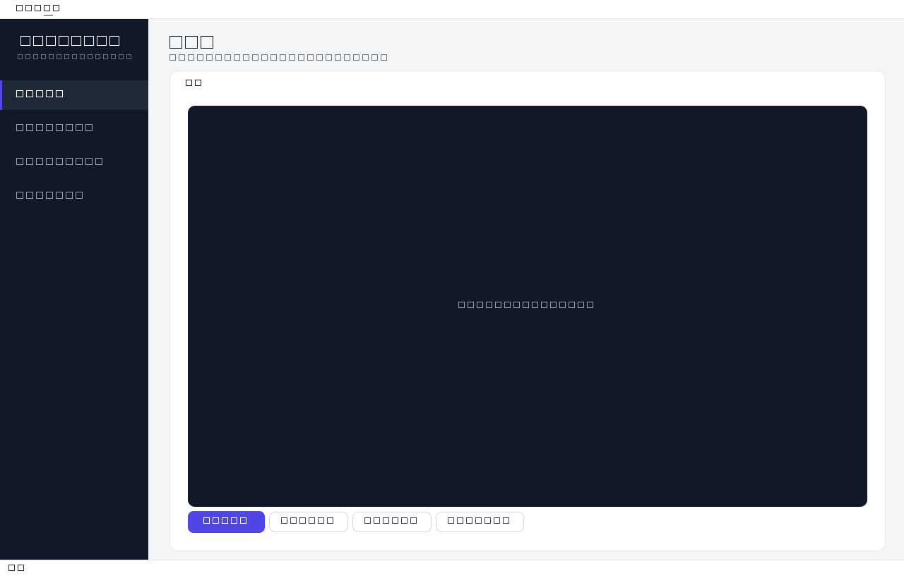

# PhotoMosaic Studio · 照片马赛克工作室

把任意照片变成用你自己的照片库拼成的巨型马赛克拼图。自适应四叉树细节、智能分配、GPU 加速、超大流式 BigTIFF 输出、应用内 1:1 像素查看器。

*PhotoMosaic Studio — turn any photo into a giant mosaic collage built from your own photo library. Adaptive quad-tree detail, smart tile assignment, GPU acceleration and streamed BigTIFF output for gigapixel results. Clean-room implementation, MIT licensed.*

[](https://github.com/A4hun/photomosaic-studio/actions/workflows/ci.yml)
[](LICENSE)
[](https://www.python.org/)

## 效果



## 特性

- **27 维 LAB 特征匹配**：3×3 子块亮度/色彩结构，比单一平均色更懂局部内容
- **智能分配**：随机顺序 + 复用均衡 + 邻域去重，相邻重复率 9.05% → 0.03%
- **自适应四叉树**：细节区切小块、平缓区保大块；**自由套索**圈选任意形状强制细化
- **柔光融合**：瓦片向所在格均色做 SoftLight，强度默认 55%（对齐经典软件观感）
- **GPU 加速**：CuPy 可用时匹配自动走 GPU（实测 12 倍），显存按需分块
- **超大输出**：>2 亿像素自动流式渲染成 BigTIFF，峰值内存与输出总面积解耦；条带级断点续传
- **应用内查看器**：超大图放大到 1:1 按需读条带，无需外部软件
- **断点续传**：扫描建库与渲染生成都支持中断续跑

## 安装

### 方式一：Windows exe（推荐给非开发者）

从 [Releases](https://github.com/A4hun/photomosaic-studio/releases) 下载 `photomosaic-studio.exe`，双击即用。

### 方式二：pip 安装（开发者/跨平台）

```powershell
# Windows / Linux / macOS
pip install -e ".[gui]"
photomosaic gui
```

## 60 秒出图

```powershell
# 建库（一次，可复用）
photomosaic ingest D:\我的照片 --db tiles.db --variants orig,mirror
# 渲染
photomosaic make 主图.jpg --db tiles.db -o mosaic.png --levels 4
# 一步到位
photomosaic run 主图.jpg D:\我的照片 -o mosaic.png
```

## 使用

### CLI 参数

| 参数 | 说明 |
|---|---|
| `--cells-x` | 网格宽度（格数）；越大越细腻 |
| `--cell-px` / `--tile-px` | 输出每格像素尺寸 |
| `--top-k` | 近优随机候选数（1=总选最优，越大越随机） |
| `--max-reuse` | 单瓦片最大复用次数（0 不限） |
| `--radius` | 平均色预筛半径（0-441，RGB 欧氏距离） |
| `--seed` | 随机种子（同种子同库 ⇒ 输出逐字节确定） |
| `--variants` | 瓦片变体：`orig,mirror,r90,r180,r270` |
| `--levels` | 自适应细分深度（1=均匀网格） |
| `--detail-threshold` | 细节能量阈值（默认 25，越大越保守） |
| `--blend` | 柔光融合强度 0–1（默认 0.55） |
| `--out-width` | 输出宽度（像素），高按主图比例 |
| `--poster` | `2x3` / `3x2` 海报分页 |
| `--stream-threshold` | 输出像素超过该值切换流式 BigTIFF（默认 2 亿） |
| `--stream-strip-rows` | 调试：强制流式条带高度 |
| `--region` | 手动强制细化区域（可重复） |
| `--device` | `auto` / `cpu` / `gpu` |

### GUI 四步

1. **① 主图像**：打开要做成马赛克的大图
2. **② 单元图数据库**：加照片文件夹，建一次库随便换主图
3. **③ 网格与嵌套层级**：调格子粗细；**Ctrl+左键拖拽 = 套索圈选任意形状并细分到最细**；Ctrl+右键拖拽 = 套索取消细分；Ctrl+Shift = 矩形框选；左键 = 细分一级；右键 = 合并一级
4. **④ 生成与修正**：生成；超大输出可用「放大查看细节」1:1 浏览；导出 PNG/JPEG/BMP/TIFF，海报分页

## 超大分辨率输出

输出超过 **2 亿像素** 自动切换为分条带流式渲染：峰值内存与输出总面积**解耦**——几百亿像素也能稳定跑完。输出为 BigTIFF（自研纯 Python strip 写入器），崩溃/取消后重跑同参数自动续传；同时生成 ≤4096px 降采样预览。

实测（4080 Laptop / 40 张 512px 瓦片库 / 93,397 格四级细分）：3.41 亿像素 → 114 秒、峰值内存 2.3GB、输出 1GB。

## 算法说明

1. **瓦片库**：扫描文件夹 → MD5 去重 → 中心裁剪到单元格比例 → 生成变体（orig/mirror/r90/r180/r270）→ 每张瓦片计算 27 维特征 + 平均 RGB 存入 SQLite
2. **主图网格化**：主图缩到 `cells_x × cells_y` 网格，每格计算同样特征
3. **匹配**：平方欧氏距离（BLAS 矩阵向量积）+ 可选半径预筛 + top-k 近优随机 + 复用上限
4. **自适应多级**：以基础网格为第 1 级，对局部细节能量（梯度+对比度）超过阈值的格子递归切成 2×2
5. **组装**：按选中瓦片贴缩略图，输出 PNG/JPEG/BMP/TIFF/BigTIFF

## 测试

```powershell
python -m pytest tests -q
```

## 已知限制

- 流式超大输出的 GUI 点击替换/非 TIFF 导出暂不支持（状态栏有提示）
- 亿级格子数的 stats 内存未优化（流式解决像素数维度，非格子数维度）
- 套索取消细分语义为"相交即合并"
- exe 版不带 GPU 加速（pip 安装 + 自装 cupy-cuda12x 才有）

## 项目结构

```
photomosaic/
  features.py   # 27 维 3x3-LAB 特征、平均色、比例裁剪
  db.py         # SQLite 瓦片缓存（特征+缩略图+MD5）
  library.py    # 文件夹扫描、去重、变体、入库
  match.py      # 半径预筛 + 平方距离 + top-k 近优随机 + 复用上限
  planner.py    # 智能分配（复用均衡 + 邻域去重）
  grid.py       # 四叉树网格编辑模型（含自由套索选区）
  render.py     # 主图网格化、组装、统计（含流式渲染接入）
  bigtiff.py    # 纯 Python BigTIFF strip 读写器（可续写）
  streaming.py  # 分条带流式渲染（百亿像素级）
  bigview.py    # 超大图分段查看器
  cli.py        # ingest / make / run 子命令
tests/          # 特征、匹配、端到端、确定性、套索、流式、查看器、发布回归
scripts/        # demo.py、verify_*.py、build_exe.py、make_icon.py
docs/img/       # 界面截图
```

## 许可证

MIT License © 2026 PhotoMosaic Studio Contributors
